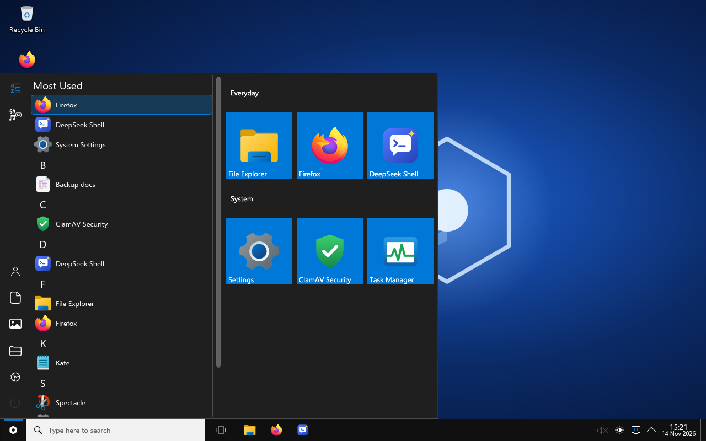
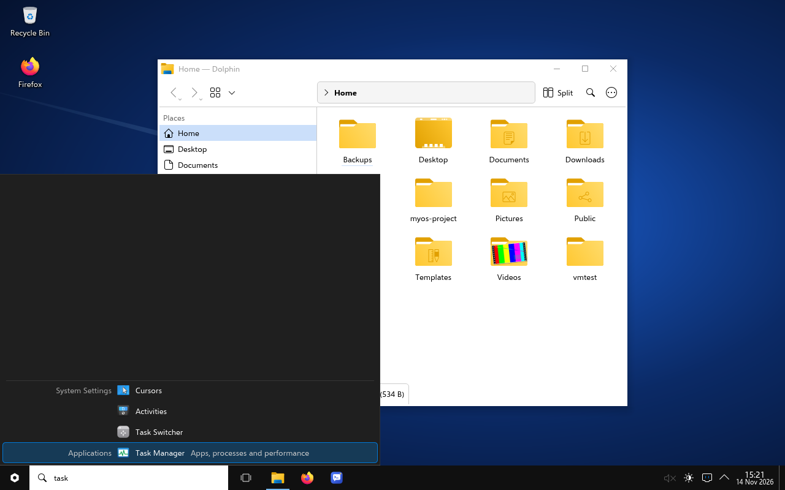
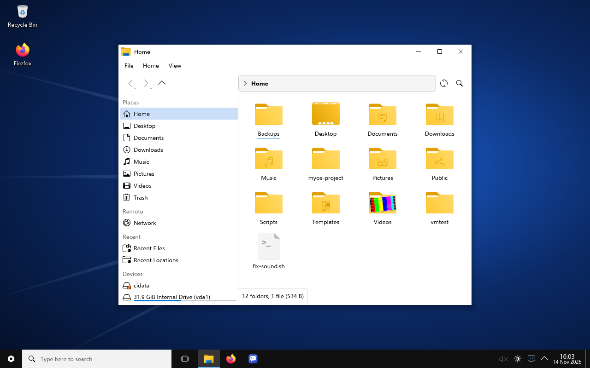
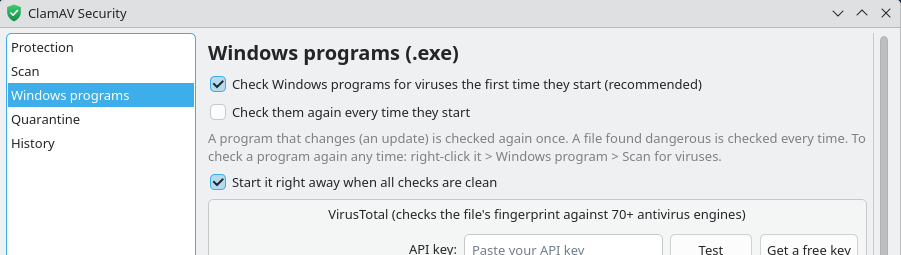
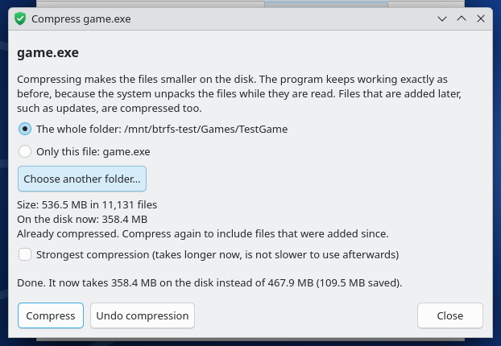
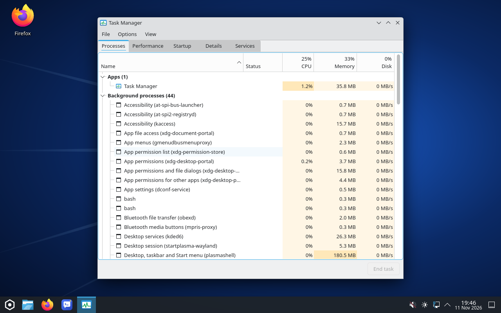
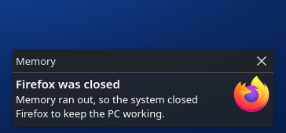
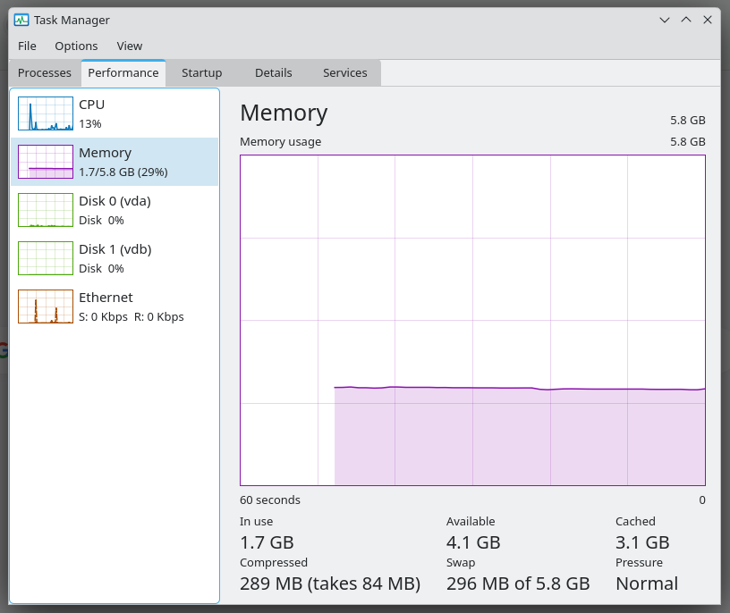

# MyOS: a Windows 10-style Linux with a local DeepSeek AI

Your own operating system, built from Debian 13 ("trixie") and KDE Plasma 6, set up to look
and work like Windows 10. It comes with a built-in AI assistant that runs entirely on your PC.
Rename it by changing `OS_NAME` in [config.env](config.env).

## What's inside

| | |
|---|---|
| **The Windows 10 look** | A dark, flat taskbar: Start button, the **Type here to search** box (Win+S), the **Task View** button (Win+Tab), pinned apps with a blue line under open ones, the tray, a small clock with the date under it, and the thin show-desktop strip in the corner. A **Start menu with tiles**: all apps A–Z on the left, blue tiles on the right, and typing searches. White windows with Windows-style title bars (wide minimize, maximize and close buttons; close turns red), **File Explorer** laid out like Windows 10's (File / Home / View menus above back, forward, up, the address bar, refresh and search; the title shows just the folder), the blue #0078D7 accent, Windows 10-style icons with yellow folders, the Selawik font (the letter widths of Windows' Segoe UI), a white mouse pointer and the Recycle Bin on the desktop. MyOS keeps its own name and logo: no Microsoft logos, wallpapers or fonts are included. Windows 10 shortcuts (table below). |
| **Apps** | **Firefox**, **Settings**, **DeepSeek Shell** (the AI), **ClamAV Security** and **Task Manager**. Also **File Explorer** (KDE's Dolphin, named "File Explorer" in the Start menu and taskbar), pinned to the taskbar like on Windows. You also need it to open an .exe's Properties. Set `FILE_MANAGER="no"` to leave it out. Nothing else. |
| **Task Manager** (Ctrl+Shift+Esc) | Built like the Windows 10 one. **Processes:** your apps (one line per app, however many processes it runs), background processes and system processes, with CPU, memory and disk use, and **End task**. **Performance:** live graphs for CPU, memory, each disk, network and (AMD/NVIDIA) graphics card. **Startup:** switch apps that start at login off and on. **Details:** every process. **Services:** start, stop and restart system services. |
| **Memory, like on a Mac** | Memory is compressed before anything goes to the disk, the way macOS does it. With swap space on the disk, compressed memory (zswap) sits in front of it and only the coldest data goes to the disk; without, a compressed swap inside the RAM. In the test machine (6 GB) 26 to 31 apps of 300 MB stayed open, against 15 without compression. No pop-up warnings while you work. If memory does run out, the app using the most is closed instead of the whole PC freezing, and one notice says which. Firefox unloads tabs you haven't looked at when memory is low. Task Manager shows how much is compressed and the memory pressure. |
| **Disk space, like Game Compressor** | Right-click an .exe → **Properties** → **Windows compatibility** → **Compress to save disk space** (or right-click any folder). The game's files are compressed in place (Btrfs zstd) and unpacked while they are read, so you keep playing the game exactly as before. Updates are compressed too, and **Undo compression** puts it back. The window shows what it would save before you start. |
| **Speed** | The idle virus scanner gives back its 1 GB when memory runs short. The AI model leaves memory a minute after you close DeepSeek Shell. Animations and blur switch off by themselves when there is no graphics card driver (and back on once there is). Fewer background jobs, faster app installs, and shutdown never waits more than 15 seconds for a stuck program. |
| **DeepSeek Shell** (Win+C) | A local AI you give jobs in plain words: it installs and sets up apps, writes and schedules scripts, makes shortcuts, and fixes problems. It shows its plan and you OK it once. Admin commands use the system password dialog, so the AI never sees your password. It also takes a Btrfs snapshot first, so you can undo. 25 built-in guides for Debian 13 (NVIDIA, Wi-Fi, sound, Bluetooth, games, Windows programs, printers…). |
| **Your own AI tools** | Settings → **AI Assistant** (or ⚙ in DeepSeek Shell → Tools): add a tool as a command with parameters. The AI can use it right away. |
| **Windows programs** | The first time an .exe starts, it is checked with **ClamAV**, **VirusTotal** and **ANY.RUN**, then it runs with **Wine** or **Proton**. Later starts go straight to the program (until it is updated); scan it again whenever you like. Right-click → **Properties** → **Windows compatibility** has the "Run this program with Proton" switch. GE-Proton is built in. Running `./setup.exe` in a terminal goes through the same check. |
| **Video wallpapers** | Right-click a video in File Explorer → **Set as Wallpaper**, or ask the AI (*"set this video as my wallpaper"*). Videos loop, start muted, and pause while a window is maximized or fullscreen, which saves power and keeps games fast. For a playlist, speed, blur or a lock-screen video, right-click the desktop → **Desktop and Wallpaper**. Uses the [Smart Video Wallpaper Reborn](https://github.com/luisbocanegra/plasma-smart-video-wallpaper-reborn) plugin. |
| **Installer** | A graphical installer (Calamares) on the USB stick. Btrfs by default, so snapshots work. |
| **Automatic updates** | When a new version of MyOS builds on GitHub, installed PCs install it by themselves within a few hours: the apps, settings and look. A snapshot is taken first, and a quiet note in the notification history (no pop-up) says when it happened. `myos-update --status` shows the version, `sudo myos-update` installs a new one right away. See [Updates](#updates). |

<p>



</p>

The look is built from free parts: the Start menu is [Tiled Menu](https://github.com/Zren/plasma-applet-tiledmenu)
(GPL-2.0+), the icons are [We10X](https://github.com/yeyushengfan258/We10X-icon-theme) (GPL-3.0;
the build leaves out its pictures that copy Microsoft logos, such as Windows, Edge and Office),
and the font is [Selawik](https://github.com/microsoft/Selawik) (SIL Open Font License). The
taskbar style, title bars, colours, search box, Task View button and show-desktop strip are
MyOS's own (in `desktop/`). Settings → Colors & Themes → Global Theme → **Breeze** switches to
KDE's own look, and **Windows 10 Style** back.

## Good to know before you start

- **"Full" DeepSeek can't run on a home PC.** The full DeepSeek-R1 model is 671 billion parameters
  (a 404 GB download). This system uses the official distilled R1 models instead.
  The AI picks the best one for your graphics card on first start:

  | Your graphics card memory (VRAM) | Model | Download |
  |---|---|---|
  | 24 GB (RTX 3090 / 4090 / 5090) | deepseek-r1:32b | 20 GB |
  | 8–16 GB (RTX 4060 Ti, 4070, 5060 Ti, 5070, RX 7800 XT…) | deepseek-r1:8b (newest, R1-0528) | 5.2 GB |
  | no GPU, 16 GB+ RAM | deepseek-r1:8b on the CPU (slow) | 5.2 GB |

  **Prefer Qwen (or another model)?** Any model from [ollama.com](https://ollama.com/library) works.
  Qwen is listed in Settings → AI model: `qwen3.5:9b` (about 7 GB, for 10–16 GB cards) or
  `qwen3.8:27b` (18 GB, for 24 GB cards). These are newer than the DeepSeek models and built for
  using tools. Switch any time from the dropdown at the top of DeepSeek Shell. To make one the
  default, set `DEFAULT_MODEL` in config.env; the first-start screen then offers that model.

  **Buying advice:** for this AI, get an **NVIDIA GPU with 12–16 GB of VRAM**, plus 32 GB of RAM.
  AMD works too, with an extra step the AI does for you.
- **NVIDIA RTX 50 cards** need a newer driver than Debian ships. The AI's NVIDIA guide uses
  NVIDIA's own Debian 13 repository for these cards. After installing, click "🩺 Fix my PC"
  or say *"install the NVIDIA driver"*.
- **VirusTotal** needs your own free API key (free account at virustotal.com).
  **ANY.RUN** needs an ANY.RUN plan that includes API access; their free plan has none.
  Without keys, ClamAV still checks every .exe, and the window shows "not set up" for the online checks.
  Enter keys in ClamAV Security → Windows programs. Only a file's fingerprint is sent, unless you
  choose to upload the file.
- **Tested so far:**
  - 282 automated tests pass (DeepSeek Shell 54, ClamAV Security 50, desktop 65, Task Manager 52,
    speed and memory 33, updates 28) on Qt 6.8.2, the version in Debian 13. All 48 shell scripts
    pass shellcheck without warnings. GitHub runs them before every build.
  - **The ISO builds**: on GitHub (Actions → Build ISO) in 20 minutes, 5.7 GiB, with the Linux 7.2
    kernel from backports, GE-Proton 11-12 for x86_64, Firefox, Ollama, ClamAV signatures, the
    Properties tab and the whole Windows 10 look (all build steps reported success).
  - **On a real Debian 13 + KDE Plasma 6.3 system** (a test virtual machine), installed with this
    project's own install scripts and build hooks, and checked for real:
    - the taskbar and Start menu, File Explorer, and the AI Assistant page in Settings;
    - **the Windows 10 look**, after a restart as a new user would get it: the build step
      downloaded the Start menu, icons and font and checked their checksums; the tiled Start
      menu opened with the Win key; typing in the search box found Firefox and Task Manager;
      the Task View button showed all windows; the show-desktop strip hid and brought back the
      windows, also from the very corner pixel; the title bars showed the wide buttons and the
      red close button on hover; File Explorer showed the yellow folders; the calendar pop-up
      opened dark and square; the Recycle Bin appeared on the desktop;
    - **File Explorer like Windows 10's**, opened as a new user would: the title bar showed just
      "Home" (not "Home — Dolphin"), the File / Home / View menus opened with the renamed entries
      ("Open new window", "Options", "Layout", "Hidden items", "Refresh"), the address row was
      full width, and only the Places panel was open;
    - the Windows shortcuts, pressed as real key presses;
    - ClamAV blocking a test virus, and the check window that opens for an .exe;
    - **the check on the first start only**, double-clicking in File Explorer: checked on the
      first start, then 0.2 s from double-click to start with no check, checked once more after
      the .exe changed, and a scan asked for in Properties always ran. A setup.exe downloaded
      with Firefox and opened from its download list was checked the first time and started in
      0.6 s the second time; the same with Chromium (Chrome's open-source version, installed for
      the test and removed again): checked the first time, 0.8 s the second time;
    - the Properties tab: it compiles, shows up, and saves the Proton switch;
    - video wallpapers playing;
    - the AI with a real model (qwen3.5:2b). Its jobs: free disk space, installing Notepad, a
      daily backup script with a timer, a video wallpaper, a desktop shortcut, checking the
      sound, and refusing to delete the home folder;
    - **Task Manager:** opened with Ctrl+Shift+Esc; a second press brings the open window
      forward. End task on an app, on a program that ignores the request, and on a system
      process (after the password prompt). Startup switches are obeyed by the desktop. A
      service was started and stopped. With the process list open it uses about 2% of one
      processor core;
    - **the speed settings**, measured on that machine (4 cores, 6 GB, no graphics card):
      - a playing video wallpaper cost half to one whole processor core, a still picture none.
        Setting a video there now warns about it and pauses it behind any window;
      - animations and blur switched off by themselves; the idle desktop uses 0.1% of the processor;
      - **memory**, with stand-in apps of 300 MB each opened one by one until the PC was no longer
        usable (6 GB RAM):

        | Setup | Apps open | What stopped it |
        |---|---|---|
        | no compression, no swap | about 15 | memory full |
        | the earlier setup (compressed swap half the RAM size) | 22 | the system closed an app |
        | **now, no swap on the disk** (zram) | **26** | an app closed, lag up to 0.9 s, desktop fine |
        | **now, 6 GB swap file** (zswap) | **31**, none closed | the app in front lagged 2.5 s |

        With the swap file, up to 26 apps the app in front never lagged more than 0.35 s; 1.7 GB
        of memory was held in 0.6 GB of RAM. Both modes were chosen correctly at start-up, and
        switching between them on a running system works;
      - **when memory runs out**, with test apps started exactly like Start-menu apps: with
        apps racing through more memory than fits, the kernel closed one busy app within a
        minute, never an idle one or the desktop, and exactly one notice named it. With about
        8 GB in active use on 6 GB of RAM, all apps stayed open for 5 minutes, only slower.
        systemd-oomd was tried as an extra guard and taken out: its "swap 90% full" rule closed
        two apps one second apart where one was enough, and its "waiting for memory for 20 s"
        rule (tested with a lowered limit, since the kernel always acted first) closed an idle
        background app before the one causing the trouble;
      - **Compress**, on a Btrfs drive laid out exactly like an install (subvolumes `@` and
        `@home`, the installer's mount options, snapper on `@`), with a 536.5 MB test game in
        `~/.local/share/Steam/steamapps/common`: 549 MB on the disk before, 359 MB after (the
        estimate said 357 MB), and the drive really had 185 MB more free space. Every file was
        unchanged, the program still ran from the compressed folder, new files were compressed,
        and undo restored it. A copied game folder and a game in a snapshot were left alone (no
        extra space used), and compressed fine once the copy or snapshot was gone. On Linux 7.2
        (from Debian's backports, tried and removed again) the strongest level gave 353 MB
        instead of 360 MB and read just as fast. On ext4 it explains why it can't. The size check
        needs no password and refuses other users' folders;
      - **a real Windows program after compressing**: a 6 MB Windows .exe (built for Windows on
        ARM, since the test machine is ARM) in a 542 MB game folder, run by Wine 10. Compressed,
        game.exe itself took 1.9 MB on the disk; the program read all 11,307 of its files with
        the same checksums as before, wrote a save game (compressed by itself, 1.3 MB for 4 MB),
        and from a cold start it was ready in 13 s against 38 s uncompressed, because less had
        to be read from the disk. Double-clicked in File Explorer, it went through the virus
        check ("No threats found") and opened its window. Undo, then compress again, gave the
        same result;
      - the idle virus scanner was stopped when memory was short (964 MB freed), and the next
        scan started it again. It stays loaded while there is memory to spare;
      - shutting down took 13.5 s instead of 33 s; installing a small package 4.5 s instead of 6 s.
  - That testing found and fixed 12 problems in the first round, among them: the Start menu
    favorites, the AI engine stopping when memory ran out, "Notepad" not being found after
    installing it, and commands that open an editor hanging. The Task Manager round found and
    fixed 9 more in the new code before it went in, such as a wrong name for virtual disks and
    the process list redrawing itself more often than needed. The memory and Compress rounds
    found 15 more, among them: .exe files opened from Chrome and other apps being refused by
    KDE (now handed to the check); GNOME's desktop portal helper (installed alongside KDE's) leaking
    a handle for every program that asked it something and then keeping one processor core
    busy for hours (now only KDE's portal is used); compressed memory failing at start-up now and then because the
    new device was still busy (now retried: 20 of 20 starts worked); compressing a copied or
    snapshotted game using 345 to 386 MB *more* space while saying it saved some (now those
    files are left alone); Btrfs leaving the last part of big files (up to 128 MB each)
    uncompressed in some cases, and skipping files that were not on the disk yet (now flushed
    first, checked afterwards and redone); a file named like a Python module (bisect.py) in the
    home folder stopping MyOS's apps from starting; Plasma's "app was closed" notice coming two
    or three times; systemd-oomd closing the wrong apps; and the Compress window cutting off its
    text. The Windows 10 look round found 3 more: the newest Tiled Menu doesn't load on
    Debian 13's Plasma 6.3 (the build now adapts the one line that changed in Plasma 6.4); the
    icon set drew 65 pictures as copies of Microsoft logos, for example the LibreOffice icons as
    Office's and the web browser icon as Edge's (now left out, so the neutral KDE icons show);
    and KWin (the window manager) started with KDE's own icons for the title bars (now reloaded
    at login). The File Explorer round found 4 more: KDE ignored the new layout file because a
    note in it contained the word "version" before the real version number (KDE reads the
    first one); menus placed in a toolbar opened only from their small arrow (now they are in
    the menu bar, which Dolphin hides on a first start unless told otherwise); the Refresh
    button's name was wrong (checked against the 132 action names of the real app now); and KDE
    added an untitled menu for "Show Toolbar" (it now goes into View). The first ISO builds found
    3 more: the backports kernel (Linux 7.2) also needs the newer linux-base from backports; the
    ISO step needs apt-utils on the build machine; and GE-Proton now publishes separate x86_64 and
    ARM downloads, and the ARM one was taken (now always the x86_64 one, checked by its checksum).
  - **Not tested yet:**
    - booting and installing the ISO on a PC (installer, Secure Boot, the 2-second boot menu);
    - NVIDIA/AMD graphics cards, including Task Manager's graphics card page and the effects
      switching back on once a driver is in use (only the "no driver" case could be tried);
    - Task Manager's Wi-Fi details (the test machine has a wired network only);
    - x86 Windows games and Proton (the test machine is ARM-based, so the Windows test program
      was built for ARM and run with Wine; Proton needs an x86 PC);
    - Compress on a PC actually installed from the ISO (the test drive was laid out like one,
      next to the test machine's ext4 system);
    - zswap with a swap partition on a real SSD (tested with a swap file in the virtual machine).
  - If the Properties tab ever fails to compile after a KDE update, the build continues, and the
    same switch is under right-click → Windows program → Compatibility settings. Expect to fix a
    thing or two on the first build; `out/build.log` shows what happened.

## 1. Build the ISO

You need about 25 GB of free disk space and 20–60 minutes.

**On your new PC, if it comes with Windows (easiest):**
1. Install [Docker Desktop](https://www.docker.com/products/docker-desktop/) and let it set up
   WSL 2. Restart when it asks.
2. Open the Microsoft Store, install **Ubuntu**, and open it once (it asks you to pick a user
   name and password for Ubuntu).
3. In Docker Desktop: **Settings → Resources → WSL integration**, switch on **Ubuntu**, then
   **Apply & restart**.
4. Put `myos-project.tar.gz` (this project as one file) in your Windows **Downloads** folder.
   In Ubuntu, unpack it into Ubuntu's own home folder, with your Windows user name in place of
   `YOU`:
   ```bash
   tar xzf /mnt/c/Users/YOU/Downloads/myos-project.tar.gz -C ~
   ```
   Keep the project inside Ubuntu (not under `/mnt/c`): the build is much faster there and the
   scripts keep their permissions.
5. Build it:
   ```bash
   cd ~/myos-project && ./build.sh
   ```
6. Copy the finished ISO to your Windows Downloads folder for the next step:
   ```bash
   cp ~/myos-project/out/*.iso /mnt/c/Users/YOU/Downloads/
   ```

**On Linux:** install Docker (`sudo apt install docker.io`) or Podman, then run `./build.sh`.
On Debian 13 you can also run `./build.sh --native`.

**On a Mac:** it works with Docker Desktop, but Apple Silicon has to emulate a PC, which takes several hours.

**Without installing anything (GitHub):** put this folder in a GitHub repository. Every change
pushed to its main branch is tested and built (or open **Actions → Build ISO → Run workflow**);
download the ISO from the finished run under **Artifacts** (kept 30 days). Each build that works
is also published as an update for installed PCs (see [Updates](#updates)). This works best with
a public repository; private ones on a free account have little artifact storage.

The ISO lands in `out/` (for example `out/myos-20261105-amd64.iso`, plus a `.sha256` checksum;
GitHub's builds carry the version instead of the date: `myos-2026.11.16-7-amd64.iso`).

## 2. Install it

1. Write the ISO to a USB stick (8 GB+) with [Rufus](https://rufus.ie) (Windows) or
   [balenaEtcher](https://etcher.balena.io). If Rufus asks how to write it, pick **DD Image**
   mode (it copies the image exactly, so Secure Boot keeps working).
2. Boot from it: press the boot-menu key right after power-on (often F12, F11, F8 or Esc).
   Secure Boot can stay on.
3. Try it out, then double-click **Install MyOS** on the desktop. To keep Windows, pick
   "Install alongside" in the installer.
4. After the first restart, open DeepSeek Shell (Win+C) and click **Download** to get the AI model.
   It's a one-time download; after that the AI works offline.

**A quick look after the first start.** The Windows 10 look was tested in a virtual machine
with the same install scripts, but not yet from a built ISO, so check these once (seconds each):
- the taskbar is dark: Start button, **Type here to search**, Task View, pinned apps, tray, the
  clock with the date, and the thin strip in the bottom-right corner;
- Win opens the Start menu with tiles, Win+S the search box, Win+Tab all windows;
- Win+E opens File Explorer with yellow folders and File / Home / View on top, and its title
  shows just the folder;
- windows have the wide minimize / maximize / close buttons, and close turns red;
- the Recycle Bin is on the desktop.

If something looks like plain KDE instead, search `out/build.log` on the build PC for
`0420-windows10-look`: that step downloads the Start menu, icons and font. A network hiccup is
the usual cause; run `./build.sh` again.

## Updates

**New versions reach every installed PC by themselves.** Change the project and push it to the
main branch on GitHub: the workflow runs the tests, builds the ISO, and when that works publishes
a release named after the date and run number (for example `v2026.11.16-7`) with the update
package (the whole project at that version). Changes to README.md or docs/ alone make no new
version.

On each installed PC, `myos-update` looks for a newer release 10 minutes after the start and
then every 6 hours (not on battery, and not in the USB stick's live session). When there is one,
it downloads the package, checks its checksum, takes a snapshot (Btrfs), and runs the package's
`updates/apply.sh`, which:
1. installs the new DeepSeek Shell, ClamAV Security, Task Manager, speed settings, desktop and
   updater with the settings the ISO was built with (`/etc/myos/build.conf`);
2. downloads or compiles again what the ISO build downloads or compiles (Start menu, icons, font,
   video wallpaper plugin, Properties tab), but only when the files those come from changed;
3. runs the new one-time changes in `updates/migrations/` (for example installing a Debian
   package that a new version adds; see the README there).

Some changes (taskbar, Start menu) show after the next sign-in. If installing fails, the PC keeps
its version and tries again a day later; a shutdown waits for an install that is under way.

```bash
myos-update --status
```

```bash
sudo myos-update
```

The first shows the installed version and the last check, the second installs a new version
right away (`myos-update --check` only looks). To stop the automatic installs, set `AUTO=no` in
`/etc/myos/update.conf`. Where PCs look is `UPDATE_REPO` in [config.env](config.env) (your
repository; empty = no automatic updates).

Good to know:
- Whoever can push to the repository's main branch can change every installed MyOS (updates
  install as admin). Protect the GitHub account with two-factor sign-in.
- Debian's own packages (Firefox, KDE, the kernel, security fixes) are not part of this. Ask the
  AI to "update everything", or run `sudo apt update && sudo apt full-upgrade`.
- A PC installed from an ISO built before the updater existed (`myos-20261115-amd64.iso`) does not
  update itself: install from a newer ISO.

## Windows 10 shortcuts

| Keys | Does |
|---|---|
| Win | Start menu |
| Win+E | File Explorer |
| Win+I | Settings |
| Win+C | DeepSeek Shell (the AI) |
| Win+S | Search box on the taskbar |
| Win+R, Win+Q | Run / search (KRunner) |
| Win+D / Win+M | Show desktop / minimize all |
| Win+L | Lock |
| Win+Tab | Task View (all windows), also the button next to the search box |
| Win+← / → | Snap window left / right |
| Win+↑ / ↓ | Maximize / minimize |
| Win+Shift+← / → | Move window to the other monitor |
| Win+Ctrl+← / → | Switch virtual desktop |
| Win+1…9 | Open pinned taskbar app |
| Win+V | Clipboard history |
| Win+. | Emoji picker |
| Win+P | Display mode (projector) |
| Win+Space | Switch keyboard layout |
| Alt+Tab, Alt+F4 | Switch windows, close window |
| Ctrl+Shift+Esc | Task Manager |
| Ctrl+Alt+Del | Log out / shut down |

Snipping Tool (Win+Shift+S / PrtScn) works once that app is installed. Ask the AI:
*"install a screenshot tool"*.

## Using the AI

### Just tell it what you want done

Type a request and the AI does the whole job. Examples:

- *"Install Spotify and pin it to the taskbar"*
- *"Set up OBS for recording my screen, and open Discord when I log in"*
- *"Make me a script that backs up my Documents to my USB drive every Friday at 18:00"*
- *"Make me a script that sorts my Downloads into folders by file type, and put it in the Start menu"*
- *"Make yourself a tool that shows my battery health"*
- *"Set ~/Videos/ocean.mp4 as my wallpaper, with sound"*

For a job with several changes, the AI first shows its plan. Click **Go ahead** once and it does
every step without asking again. On a single change you can click **Allow all for this task** for
the same effect. Dangerous commands still ask, and admin commands need your password once.

- **Apps** are installed from Flathub just for you, so no password is needed. Windows names work
  too: *"install Notepad / Snipping Tool / Calculator"*.
- **Scripts** go in the `Scripts` folder in your home folder and are checked for mistakes before
  they're saved. Scripts with a Start menu entry run in a small window that shows their output. If
  one fails, **Ask the AI to fix it** sends the error back to the AI. Scheduled scripts work like
  Windows Task Scheduler: daily, hourly, on weekdays, at login, and so on.
- **Shortcuts:** desktop, Start menu, taskbar, or start at login.
- The welcome screen's **Set up an app for me** and **Make me a script** buttons start the request for you.

### Other things to know

- **🩺 Fix my PC** checks drivers, firmware, services and errors, then offers fixes.
- Ask anything: *"my sound isn't working"*, *"make the text bigger"*, *"why is my PC slow?"*.
- The AI model takes several GB of memory while it is loaded. It leaves memory a minute after
  you close DeepSeek Shell, or 5 minutes after the last answer if you leave the window open.
- Start a message with `!` to run a command yourself (`!!` runs it as administrator). The AI sees
  the output in your next message.
- **Settings (⚙):** pick or download models, add tools, and choose how often the AI asks
  (before every action / before changes / never). Dangerous commands always ask.
- **Undo:** say *"undo the last change"*. The AI uses the snapshot taken before it.
- **Desktop broken?** Press Ctrl+Alt+F3, log in, and run `deepseek-shell --cli`.

### Adding a tool

In Settings → AI Assistant → **Add tool…**:

- **Name:** `check_disk_space`
- **Description:** what it does and when the AI should use it
- **Command:** `df -h {path}`, where `{path}` is filled in (and safely quoted) from a parameter
- **Parameters:** `path`, type string, required
- Choose whether to be asked first, and whether it needs administrator rights. Use **Test…** to try it.

Tools are plain JSON files in `~/.config/deepseek-shell/tools/`. The built-in examples are
`disk_space`, `weather` and `scan_for_viruses`. You can also drop your own fix notes (Markdown) into
`~/.config/deepseek-shell/knowledge/`, and the AI will search them.

## Windows programs (.exe)

- **Double-click** → virus check (ClamAV, VirusTotal, ANY.RUN) → runs with Wine. A clean file
  starts right away. Suspicious or unknown files ask you first. Dangerous ones are blocked, with
  **Quarantine** offered.
- **Checked on the first start only.** After a program has been checked and started once, it
  starts straight away (0.2 s instead of 2 s or more in the test). It is checked again when it
  changes (an update or a different file under the same name); a file found dangerous is checked
  every time. A scan you start yourself always runs: right-click → **Windows program** →
  *Scan for viruses*, Properties → **Windows compatibility** → *Scan for viruses now*, or the
  ClamAV Security app. To check at every start again: ClamAV Security → **Windows programs** →
  *Check them again every time they start*.

  
- **From browsers and other apps:** clicking a downloaded .exe in Firefox's or Chrome's download
  list goes through the same check (the first time) and then runs it. So does anything that
  opens files with `xdg-open` (Electron apps, most non-KDE apps): KDE itself refuses .exe files
  there ("launching executables is not allowed in this context"), so MyOS puts a small
  `kde-open` in /usr/local/bin that hands Windows programs to the check and everything else to
  KDE's own. A KDE app that opens files by itself may still refuse; use File Explorer then.
- Double-clicking a program never asks "Execute or Cancel?" (KDE's default asks every time):
  .exe files go to the check above, Linux programs and AppImages simply start. A shell script
  that is marked as executable starts too, like a .bat file on Windows.
- **Proton:** right-click → **Properties** → **Windows compatibility** → tick
  *"Run this program with Proton"*. The right-click → **Windows program** menu also has
  *Run with Proton (this time)*, *Compatibility settings* (Proton version, a separate C: drive,
  Steam-style launch options such as `gamemoderun %command% -windowed`) and *Scan for viruses*.
- The first Proton start downloads Valve's Steam runtime once (about 500 MB).
- Default runner, API keys, quarantine and history are in **ClamAV Security**.
- **Compress to save disk space** (like Game Compressor): Properties → **Windows compatibility** →
  *Compress to save disk space…*, right-click an .exe → **Windows program** → *Compress*, or
  right-click any folder. It takes the program's whole folder (the game's folder when the .exe
  sits in `bin/` or `Binaries/Win64/`; only the file itself in Downloads or on the Desktop).
  Files are compressed in place with Btrfs's zstd compression and unpacked while they are
  read, so the .exe and the game keep working exactly as before (Wine and Proton read the
  same bytes as ever). Files added later, such as updates, are compressed too.
  *Strongest compression* saves a little more (2% more in the test), takes a bit longer, and
  needs Linux 6.15 or newer. Debian 13 has 6.12, so it uses the normal level there and the
  window says so. **Undo compression** restores the files. Already packed data (videos, most
  game archives) hardly shrinks. Close the game first.
  - **Copies and snapshots are left alone.** On Btrfs a copied folder (cp or File Explorer) and a
    system snapshot share their data with the original. Compressing a shared file would store
    it twice and fill the drive instead of freeing it, so such files are skipped, and the window
    says how much and why. Delete the copy (or let the snapshot be cleaned up) and compress again.
  - It checks its own work: if Btrfs left part of a file uncompressed although it would pack
    (Linux 6.12 sometimes stops early inside big files), that file is done again.
  - It works on Btrfs drives only, which is what the installer uses by default. In a terminal:
    `myos-compress --text GAME_FOLDER`.
  

## Task Manager and speed



- **Task Manager:** Ctrl+Shift+Esc, or Start menu → Task Manager. Click a column (CPU, Memory,
  Disk) to see what uses the most. **End task** asks a program to quit and stops it by force if
  it is still there 3 seconds later. System processes ask for the administrator password first;
  the taskbar gets **Restart** instead of End task, like Windows Explorer does.
- **Visual effects:** Task Manager → Options → Visual effects, or the command
  `myos-performance fast` / `normal` / `auto`. "Let the system choose" (the default) switches
  animations and blur off when the desktop is drawn without a graphics card driver, for example
  in a virtual machine or before the NVIDIA driver is installed.
- **Video wallpapers** cost a lot of processor time without graphics acceleration. The system
  says so when you set one there, and pauses the video whenever a window is open.
- **Memory** (what macOS does, done with Linux's own tools):
  - *Compressed memory.* With swap space on the disk: zswap (zstd) keeps compressed pages in
    RAM, up to a third of it, and moves only the coldest ones to the disk. Without: a compressed
    swap in RAM (zram) as big as the RAM, up to 8 GB. Never both, because that would compress twice.
    `cat /run/myos-memory-mode` says which one is in use. Adding a swap file switches to zswap at
    the next start.
  - *Swap only what is cold.* The system keeps more memory free ahead of time, and never swaps
    out what was used in the last second. When even that doesn't fit, the kernel closes one app
    (the one using the most) instead of the whole PC grinding to a halt. Under heavy load short
    of that, apps get slower but stay open.
  - *No nagging.* There is no "memory is almost full" pop-up. Only if an app really has to be
    closed, one notice says which (Plasma's own notice for this came two or three times for one
    app, so it is switched off and replaced).

    
  - *Firefox* unloads tabs you haven't looked at for a while when memory is low; they reload
    when clicked.
  - Task Manager → Performance → Memory shows **Compressed** (how much, and the RAM it takes)
    and **Pressure**.

  

- **Virus scanner:** once loaded it keeps about 1 GB of memory, so scans are instant. When less
  than a quarter of the memory is free and nothing has used it for 5 minutes, it is stopped;
  the next scan starts it again, which takes 10 to 50 seconds.
- **File search:** the Start menu and the search box find apps and settings. Finding files by
  name needs file indexing, which is off to keep the disk quiet: Settings → Search → File Search
  switches it on.

## Customize the build

Everything is in [config.env](config.env): OS name, `KERNEL` (backports = newest hardware support),
`DEFAULT_MODEL`, `BUNDLE_MODEL` (puts the AI in the ISO for offline installs, +5 GB),
`AMD_GPU_SUPPORT`, `FILE_MANAGER`, `BUNDLE_PROTON`, `CLAMAV_SIGNATURES`, `VIDEO_WALLPAPERS`,
`UPDATE_REPO` (where installed PCs get new versions), `EXTRA_PACKAGES`, language and keyboard.

## Project layout

```
build.sh, config.env        build entry point and settings
scripts/container-build.sh  the build itself (runs inside a Debian 13 container)
iso/                        Debian live-build configuration: package lists, hooks, installer settings
desktop/                    Windows 10 look: taskbar layout, Plasma style (dark taskbar), window colours,
                            title bars (Aurorae), search box, Task View and show-desktop widgets, the
                            installer for the downloaded Start menu, icons and font, shortcuts,
                            wallpapers and the myos-set-wallpaper command (pictures and videos), tests
deepseek-shell/             the AI app (Python + Qt): agent, tools, safety rules, fix guides, tests
myos-security/              ClamAV Security, the .exe guard, Wine/Proton launcher, Compress, Properties tab (C++), tests
task-manager/               Task Manager (Python + Qt): processes, performance graphs, startup apps, services, tests
performance/                speed and memory: compressed memory (zswap/zram), out-of-memory guard and warning,
                            Firefox tab unloading, visual effects tool, idle virus scanner stop, tests
updates/                    automatic updates: myos-update and its timer, apply.sh (installs a new version on
                            a running system), one-time changes (migrations/), tests
.github/workflows/          the GitHub build: tests, ISO, and the release that installed PCs update from
docs/                       screenshots
```

DeepSeek Shell, ClamAV Security, Task Manager, the speed settings, the desktop setup and the
updater each have an `install.sh`. You can also install them on an existing Debian 13 KDE system with `sudo ./install.sh`.

Run the tests (needs PyQt6):

```bash
cd deepseek-shell && python3 -m unittest discover tests
```

```bash
cd myos-security && python3 -m unittest discover tests
```

```bash
cd desktop && python3 -m unittest discover tests
```

```bash
cd task-manager && python3 -m unittest discover tests
```

```bash
cd performance && python3 -m unittest discover tests
```

```bash
cd updates && python3 -m unittest discover tests
```

## If the build fails

- Look at the end of `out/build.log`. Hooks print which step failed (Firefox, Wine, Ollama, Proton…).
- Network hiccups (GitHub or Ollama downloads): just run `./build.sh` again. Downloaded packages are cached.
- Start completely fresh: `./build.sh --clean`, then `./build.sh`.
